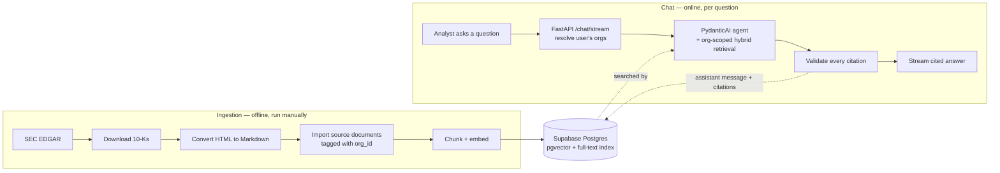
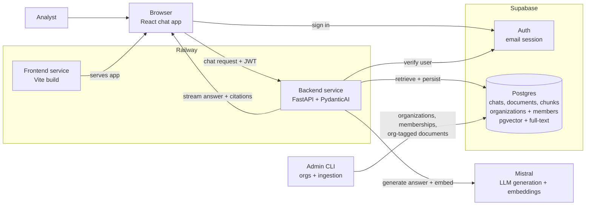
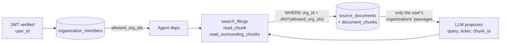

# Document Copilot

**Ask a SEC filing a plain-English question. Get a cited answer you can click straight through to the source paragraph.**


**[🚀 Live demo](https://frontend-production-cc5c.up.railway.app)** — deployed as two independent Railway services (frontend + backend). Sign-in is invite-only by design (this simulates an internal company tool, not a public SaaS), so the link is there to prove it's a real, running deployment rather than to self-serve a login. · [Backend health check](https://backend-production-b4bf.up.railway.app/health)

## The pitch

Analysts at research firms spend roughly half their week just *reading* — opening 10-Ks and 10-Qs, hunting for the numbers and language they need before they can produce a single sentence of original analysis. Document Copilot is an internal chatbot that eats that intake work: ask it a question in plain English, and it searches a corpus of filings, retrieves the exact passages that support an answer, and refuses to answer past what those passages actually say.

It's built around one non-negotiable product rule: **a wrong but confident answer is worse than no answer.** So grounding isn't a prompt — it's enforced in code. Every citation the model produces is checked against what it actually retrieved *this turn*; an answer that claims confidence with no citations, or cites a passage it never looked at, is rejected before it reaches the user.

The scenario (client: **Driftwood Capital**, a fictional independent research firm) exists to give the project a real product spec to build against — see [docs/client-brief.md](docs/client-brief.md) for the full brief, including the actual example questions the bot is expected to answer correctly.

## What it does

- **Grounded, hybrid retrieval** — every question is embedded (Mistral `mistral-embed`) *and* keyword-searched (Postgres full-text) in parallel, then fused with Reciprocal Rank Fusion so neither semantic drift nor exact-term misses lose relevant passages.
- **Citations you can actually verify** — click a citation chip and see the exact excerpt, ticker, filing type, date, and section it came from, not just a link.
- **Grounding enforced in code, not prompted** — a dedicated validator checks every citation against the chunks retrieved during that turn before the answer is ever persisted or shown.
- **A typed agent, not a prompt string** — [PydanticAI](https://ai.pydantic.dev/) gives the LLM three bounded tools (`search_filings`, `read_chunk`, `read_surrounding_chunks`) and a typed `GroundedAnswer` output, so the whole reasoning loop is testable without hitting a live model.
- **Streamed like a real chat** — SSE streaming with live status updates ("Searching filings for AAPL...") while the agent works, then a typed-out, markdown-formatted, cited answer.
- **Real auth, real multi-user history** — Supabase email auth, per-user chat threads, sign-out on token expiry.
- **Organization-scoped documents** — every filing belongs to an organization, and users retrieve only their organizations' documents. The scope is applied by the backend in every retrieval query; the LLM has no way to choose or widen it.
- **Shipped, not just scaffolded** — retrieval, grounding, citations UI, streaming, and a full production deploy are all done. See [docs/todo.md](docs/todo.md) for the build log, including real bugs found and fixed along the way (a concurrency bug in shared DB sessions across agent tool calls, a silent-stall bug traced to a missing disconnect check, a latency fix from parallelizing two sequential Mistral calls).

## How it works

Two pipelines share one database: an offline **ingestion pipeline** that turns raw SEC filings into searchable chunks, and an online **chat pipeline** that turns a question into a cited answer.



*Full turn-by-turn diagrams (retrieval fusion, agent decision loop) are in [docs/flowchart.md](docs/flowchart.md).*

## Architecture



### Access control

All organizations share one database; each document carries an `org_id`, and each user is granted organizations through `organization_members`. On every turn the backend resolves the user's organizations and passes them to the agent's tools, which add `org_id = ANY(allowed_org_ids)` to every retrieval query.



| Who | Organization | Can retrieve |
| --- | --- | --- |
| An | `amazon` | AMZN filings only |
| Bình | `meta` | META filings only |
| A user with no membership | — | nothing (the agent reports insufficient evidence) |

The LLM never queries the database and no tool accepts an organization argument, so a prompt cannot widen access; a guessed `chunk_id` from another organization is filtered out too. Admins manage organizations with `backend/scripts/manage_orgs.py` and assign documents with `ingest_documents.py --org`. The data model, request sequence, enforcement points, rollout order, and known gaps (notably RLS, not yet enabled) are in [docs/architecture.md → Access Control](docs/architecture.md#access-control).

*Full rationale for every decision here — why hybrid retrieval, why grounding is enforced server-side, why Railway/Supabase over alternatives — is in [docs/architecture.md](docs/architecture.md).*

## Stack

| Layer              | Choice                                               |
| ------------------ | ----------------------------------------------------- |
| Backend            | Python + FastAPI                                     |
| Frontend           | Vite + React SPA + TypeScript                        |
| Database           | Supabase Postgres (users, organizations, chats, documents, chunks) |
| Access control     | Organization membership → `org_id` filter on every retrieval query |
| Migrations         | SQLAlchemy models + Alembic                          |
| Retrieval          | Supabase `pgvector` + Postgres full-text search, fused with Reciprocal Rank Fusion |
| Agent              | PydanticAI (typed tools + grounded structured output) |
| Auth               | Supabase Auth (email only)                           |
| Hosting            | Railway (two services: FastAPI backend, static Vite frontend) |
| LLM + embeddings   | Mistral AI (`mistral-small-latest` + `mistral-embed`) |

## Repo layout

```text
document-copilot/
├── AGENTS.md           # agent instructions (read first)
├── README.md           # this file
├── data/                # local corpus + download/ingestion scripts (payloads gitignored)
├── docs/
│   ├── client-brief.md  # the client one-pager
│   ├── architecture.md  # system design, retrieval strategy, grounding policy
│   ├── flowchart.md     # visual pipeline diagrams
│   ├── todo.md           # phase-by-phase build log, what's shipped and how it was verified
│   └── guides/          # first-time setup guides (Supabase, backend, frontend, Railway)
├── backend/             # FastAPI service — retrieval, agent, grounding, chat API
└── frontend/            # React SPA (Vite) — chat UI, sidebar, citations
```

## Getting started

Install these before setting up `backend/` or `frontend/`:

| Tool | Version | Used for | Install |
| ---- | ------- | -------- | ------- |
| [Python](https://www.python.org/downloads/) | 3.12+ | Backend runtime | OS package manager or python.org |
| [uv](https://docs.astral.sh/uv/getting-started/installation/) | latest | Backend deps + `data/download.py` | `curl -LsSf https://astral.sh/uv/install.sh \| sh` |
| [Node.js](https://nodejs.org/) | 20+ (LTS) | Frontend toolchain | nodejs.org or `nvm install --lts` |
| [pnpm](https://pnpm.io/installation) | latest | Frontend package manager | `corepack enable && corepack prepare pnpm@latest --activate` |

You also need accounts/keys for external services: start with [docs/guides/supabase-setup.md](docs/guides/supabase-setup.md) (account + project), then create a [Mistral AI API key](https://console.mistral.ai/api-keys) — the app uses Mistral for both chat generation and embeddings, no OpenAI dependency.

### Run it locally

Once both `.env` files are configured (see [backend/README.md](backend/README.md) and [frontend/README.md](frontend/README.md)) and a corpus is ingested (see [Sample SEC data](#sample-sec-data) below), run both halves in separate terminals:

```bash
# terminal 1 — backend, http://localhost:8000
cd backend
uv sync
uv run alembic upgrade head
uv run uvicorn app.main:app --reload

# terminal 2 — frontend, http://localhost:5173
cd frontend
pnpm install
pnpm dev
```

Open `http://localhost:5173`, sign in, and ask a question about the ingested filings — you'll see live status updates while the agent searches, a typed-out cited answer, and clickable citation chips linking back to the source passage.

### Run it with Docker instead

For local dev without installing Python/uv/Node/pnpm yourself, once both `.env` files exist (Docker doesn't change what goes in them; both services still talk to your existing hosted Supabase project, no database runs in Docker):

```bash
docker compose up --build
```

First time (or after a schema change), apply migrations inside the backend container before or alongside `up`:

```bash
docker compose run --rm backend uv run alembic upgrade head
```

Both services hot-reload on file changes the same as running them natively. This is a local-dev convenience only — Railway deployment uses its own buildpack, unaffected by any of this (see [docs/guides/railway-deploy.md](docs/guides/railway-deploy.md)).

### First-time setup guides

- [Supabase](docs/guides/supabase-setup.md) — account, hosted project (dashboard or CLI)
- [Backend](docs/guides/backend-setup.md) — how the backend was bootstrapped (Alembic, package layout, Jupyter kernel)
- [Frontend](docs/guides/frontend-setup.md) — how the frontend was bootstrapped (Vite, shadcn)
- [Railway deployment](docs/guides/railway-deploy.md) — deploying the backend + frontend as two Railway services

## Sample SEC data

Use the standalone downloader to fetch a small local 10-K sample from SEC EDGAR. Edit the params at the top of `data/download.py`, especially `USER_AGENT`, then run:

```bash
uv run data/download.py
```

By default this downloads the latest 5 10-K filings for AAPL, MSFT, NVDA, AMZN, and GOOGL into year folders under `data/downloads/` and writes a `manifest.json`. Downloaded files are gitignored; the `data/` folder itself stays in git for the script and notes.

From there, converting to Markdown, importing into Supabase, and chunking + embedding are separate steps — see [data/README.md](data/README.md) for the full ingestion pipeline.

Imported documents must belong to an organization, and users only see documents of organizations they're members of. From `backend/`, create an organization, import its filings, then grant access:

```bash
uv run python scripts/manage_orgs.py create-org amazon "Amazon"
uv run python ../data/ingest_documents.py --org amazon --ticker AMZN
uv run python scripts/manage_orgs.py add-member an@amazon.com amazon
```

Users must sign in once before they can be added. Without a membership, a signed-in user's questions return no evidence.

## Project docs

| Question | Go to |
| --- | --- |
| Why is the system built this way? | [docs/architecture.md](docs/architecture.md) |
| Who can read which documents, and how is it enforced? | [docs/architecture.md → Access Control](docs/architecture.md#access-control) |
| What's the actual client brief and example questions? | [docs/client-brief.md](docs/client-brief.md) |
| Visual pipeline diagrams | [docs/flowchart.md](docs/flowchart.md) |
| Exact function names and call order for one turn? | [docs/pipeline.md](docs/pipeline.md) |
| What's shipped, and how was it verified? | [docs/todo.md](docs/todo.md) |
