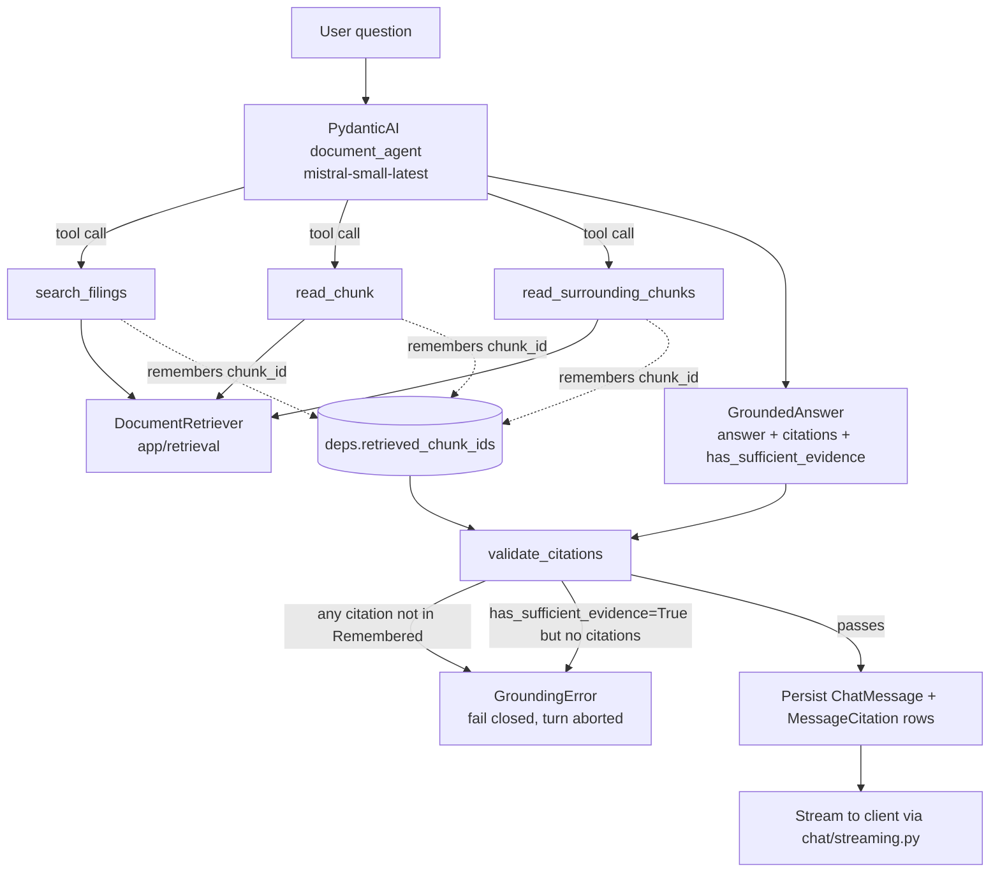

# Grounding

Enforces the product's core trust contract: every claim the agent makes must
trace back to a passage it actually retrieved this turn. This is checked in
code after every agent run — not a prompt instruction the model can drift
away from. See `docs/architecture.md`'s "Grounding and Citation Policy" for
the product rationale; this doc covers how it's implemented.

For how passages are retrieved in the first place (hybrid search, RRF,
settings), see [`app/retrieval/README.md`](../retrieval/README.md). This doc
picks up from there: once `search_filings` returns passages, how do we know
the final answer's citations are honest?

## The full turn



## Files

| File | Responsibility |
|---|---|
| `validator.py` | `validate_citations(answer, retrieved_chunk_ids)` — the enforcement point. Pure function, no I/O, called from `chat/orchestrator.py::run_chat_turn` right after the agent returns and before anything is persisted or streamed. |

## How `retrieved_chunk_ids` gets populated

`DocumentAgentDeps.retrieved_chunk_ids` (`app/assistant/deps.py`) starts as an
empty set for every turn. Each of the three agent tools in
`app/assistant/agent.py` — `search_filings`, `read_chunk`,
`read_surrounding_chunks` — routes its results through a shared `_remember()`
helper that adds every returned `SourcePassage.chunk_id` to that set before
returning to the model. So by the time the agent produces its final
`GroundedAnswer`, `retrieved_chunk_ids` holds exactly the chunks the model was
actually shown this turn — not the whole corpus, not a fixed top-k, whatever
the model chose to look at across however many tool calls it made.

PydanticAI runs these sync tool functions in worker threads and may invoke
several concurrently within one agent run. Since `SQLAlchemy`'s `Session` is
not thread-safe, every tool wraps its DB access in `with ctx.deps.db_lock:`
(a `threading.Lock` on `DocumentAgentDeps`) — this was a real bug found during
live verification (concurrent tool calls raised
`InvalidRequestError`/`IllegalStateChangeError`), not a speculative
precaution.

## The validation rules

`validate_citations` enforces exactly two things:

1. **Every citation must trace to something retrieved this turn.** If
   `citation.chunk_id` isn't in `retrieved_chunk_ids`, that's a hard failure —
   the model either hallucinated a chunk id or is citing something from a
   different turn/context. Raises `GroundingError`, and the turn is aborted
   before anything is persisted or streamed (fail closed).
2. **A confident answer must have receipts.** If `has_sufficient_evidence` is
   `True`, there must be at least one citation. Claiming sufficient evidence
   with zero citations is also a hard failure.

What it deliberately does **not** enforce: `has_sufficient_evidence=False`
with real citations attached is allowed. A hedged answer — "the filings only
partially support this, but here's the relevant partial evidence" — is a
legitimate and more trustworthy shape than an unsupported confident one. This
was a live-verification finding, not a design guess: the agent produced
exactly this shape for a genuinely underspecified multi-year question, citing
real partial evidence while correctly declining to claim full confidence, and
an earlier stricter version of the validator rejected it. `instructions.md`
tells the model this shape is expected and preferred; the validator's job is
only to catch dishonesty (citing what wasn't retrieved, or confidence without
evidence), not to punish appropriate hedging.

## Citation shape

```python
class Citation(BaseModel):
    chunk_id: uuid.UUID
    quote_text: str
    page_number: int | None = None
    section_label: str | None = None
```

`page_number` is `None` for this entire corpus — see the retrieval README's
"Known limitation: no page numbers" section. Citations are verifiable by
filing + section + quoted excerpt instead of by page; that's the product
decision this schema encodes.

This is the *agent's* raw citation shape — what the model itself produces
and what `validate_citations` checks. For display, the API layer enriches
each citation with the source document's `ticker`/`filing_type`/`filing_date`/
`document_title`/`source_url` (via proxy properties on
`MessageCitation` reading through `chunk.source_document` — see
`app/database/models/message_citation.py` and `app/chat/schemas.py`'s
`CitationResponse`) before it reaches the frontend, over both the SSE
`citations` event and `GET /chat/threads/{id}/messages`. That enrichment is
a presentation concern, not a grounding one — it happens after validation,
using chunk ids `validate_citations` already confirmed were legitimately
retrieved.

## Where this runs

`app/chat/orchestrator.py::run_chat_turn` is the only place `validate_citations`
is called in the request path: after `document_agent.run()`, before
`chats.create_message`/`create_citations` persist anything. A
`GroundingError` here propagates up and the turn is aborted — nothing
partially-validated is ever written to `chat_messages`/`message_citations` or
streamed to the client.

`scripts/smoke_assistant.py` calls the same `validate_citations` function
standalone (against the real agent, real corpus) as a manual sanity check,
logging PASS/FAIL per question without needing a running API server.
