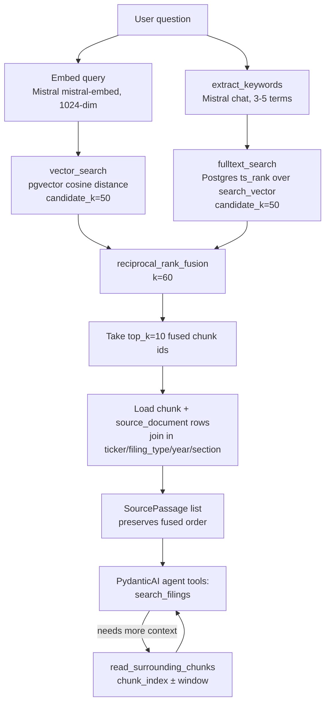

# Retrieval

Hybrid search over `document_chunks`: a pgvector semantic search and a Postgres
full-text search run independently, then get combined in Python with
Reciprocal Rank Fusion (RRF). This mirrors the pattern in
[daveebbelaar/ai-cookbook's hybrid-retrieval](https://github.com/daveebbelaar/ai-cookbook/tree/main/knowledge/hybrid-retrieval),
swapping its BM25 stage for Postgres full-text search and dropping the
cross-encoder reranker (no Cohere dependency in this stack).

## Files

| File | Responsibility |
|---|---|
| `queries.py` | Two bounded, parameterized raw-SQL queries: `vector_search` (pgvector cosine distance) and `fulltext_search` (`ts_rank` over the generated `search_vector` column). Raw SQL on purpose — pgvector's `<=>` operator and `ts_rank` aren't natural ORM expressions. |
| `fusion.py` | `reciprocal_rank_fusion` — pure function, combines any number of ranked id lists into one fused ranking. |
| `retriever.py` | `DocumentRetriever` — the only entry point agent code should use. Embeds the query, runs both searches, fuses them, and hydrates the winning chunk ids into full `SourcePassage` objects (with ticker/filing/section metadata joined in). Also exposes `read_surrounding_chunks` for neighbor-chunk context. |

## Why hybrid, and why RRF

- **Vector search** catches semantic/paraphrased matches ("cloud capacity constraints" matching "data center capacity limitations") but can miss exact rare terms.
- **Full-text search** catches exact terminology (ticker-specific jargon, exact phrases) but misses paraphrases.
- Combining them by **rank position** rather than raw score avoids the apples-to-oranges problem of merging cosine distance (unbounded-ish, smaller-is-better) with `ts_rank` (unbounded, larger-is-better) — RRF only cares about each result's ordinal position in each list.

## Default settings

All tunable defaults live as `app.config.settings` fields (backed by env vars, same pattern as the Mistral/Supabase settings) rather than hardcoded module constants — override with e.g. `RETRIEVAL_TOP_K=20` in `.env` without touching code.

| Setting | `Settings` field | Default | Notes |
|---|---|---|---|
| `top_k` | `retrieval_top_k` | 10 | Final number of fused passages returned to the caller (agent tool). |
| `candidate_k` | `retrieval_candidate_k` | 50 | How many results each of vector search and full-text search contributes *before* fusion. Kept generous relative to `top_k` so fusion has enough candidates to actually re-rank. |
| RRF fusion constant `k` | `retrieval_rrf_k` | 60 | Standard RRF smoothing constant from the original paper; also what the ai-cookbook reference implementation uses unchanged. Score contribution per rank is `1 / (k + rank)`, 1-indexed. |
| `read_surrounding_chunks` window | `retrieval_neighbor_window` | 1 (one chunk each side) | Substitutes for literal chunk "overlap": Docling's `HybridChunker` splits on document structure rather than a sliding window, so neighboring context is fetched on demand by `chunk_index` adjacency instead of being duplicated into every chunk at ingest time. |
| Embedding model | `mistral_embedding_model`, `mistral_embedding_dimensions` | `mistral-embed`, 1024 | Must match whatever embedded the corpus at ingestion time (`data/ingest_chunks.py`) — query and stored vectors have to be comparable. |
| Optional filters | — (`ticker`, `filing_type` params) | `None` | Pushed down into the SQL `WHERE` via a join to `source_documents`, not applied after the fact — keeps candidate sets accurate before fusion/limiting. |
| Keyword extraction | `retrieval_keyword_extraction_enabled` | `True` | See "Keyword extraction" below. Set to `False` in `.env` to skip the extra Mistral call and fall back to feeding the raw query into `fulltext_search`. |
| Keyword extraction timeout | `retrieval_keyword_extraction_timeout_ms` | 6000 | Passed as `timeout_ms` to the keyword-extraction chat call — kept short because this call already fails open (falls back to the raw query) on any error, so it should fail *fast* rather than risk stalling the turn. |
| Embedding request timeout | `mistral_request_timeout_ms` | 15000 | Passed as `timeout_ms` to every `embeddings.create(...)` call. Embeddings are required (not best-effort like keyword extraction), so this is longer, but still bounded — a hung Mistral call must not hang the whole chat turn indefinitely. |

## Keyword extraction

`fulltext_search` uses Postgres's `websearch_to_tsquery('english', ...)`,
whose default English stopword list only strips closed-class words
(`a/an/the/of/is`) — it does **not** strip question words or filler
(`how`, `did`, `which`, `appears`, `across`, `have`, `contributed`). Left
alone, that filler survives into the tsquery and dilutes `ts_rank`, working
against exactly what full-text search should be good at: precise term
matching.

Before the full-text branch runs, `app/retrieval/keywords.py::extract_keywords`
asks Mistral (`mistral_chat_model`) to reduce the question to 3-5 salient
keyword terms (keeping multi-word phrases like "Data Center" or "revenue
mix" together), and that keyword string — not the raw question — is what
`fulltext_search` receives. **Vector search is unaffected**: it still embeds
the full original question, since semantic embeddings benefit from complete
context.

This adds one Mistral chat call per `DocumentRetriever.search()` invocation,
on top of the existing embedding call — a single agent turn that calls
`search_filings` multiple times makes correspondingly more calls. It fails
open: any error (rate limit, malformed response, network issue) or an empty
extraction falls back silently to the raw query, so a Mistral hiccup
degrades to today's behavior rather than breaking retrieval.

Since the embedding call and this keyword-extraction call are both
independent Mistral requests on the same raw query, `search()` runs them
concurrently (`concurrent.futures.ThreadPoolExecutor`, 2 workers) rather than
paying both durations serially — this roughly halves the added latency from
turning full-text search on, without changing behavior.

## Pipeline



## Usage

```python
from app.retrieval.retriever import DocumentRetriever

retriever = DocumentRetriever(mistral_client, settings.mistral_embedding_model)
passages = retriever.search(db, "How did NVIDIA describe Data Center demand drivers?", ticker="NVDA")
```

Agent code never writes raw SQL — `search_filings`, `read_chunk`, and
`read_surrounding_chunks` in `app/assistant/agent.py` are the only sanctioned
entry points, each wrapping a `DocumentRetriever` method (see
`docs/architecture.md`'s "Retrieval Strategy").

## Known limitation: no page numbers

This corpus is ingested from HTML SEC filings, and Docling's HTML backend
never emits page provenance (`doc_items[*].prov[*]` stays empty). `page_number`
on every `SourcePassage`/`Citation` will be `None` for this entire corpus —
verify citations by filing + section + quoted excerpt instead of by page.

## Where this feeds into grounding

Retrieval only returns candidate passages — it doesn't decide what the agent
is allowed to claim. See [`app/grounding/README.md`](../grounding/README.md)
for how `retrieved_chunk_ids` gets tracked across tool calls and how
`validate_citations` enforces that every citation in the final answer traces
back to a passage this module actually returned.
