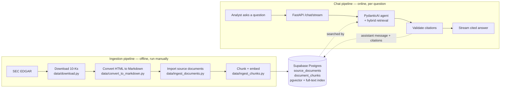
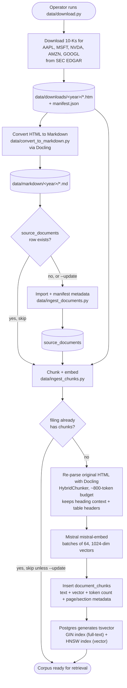
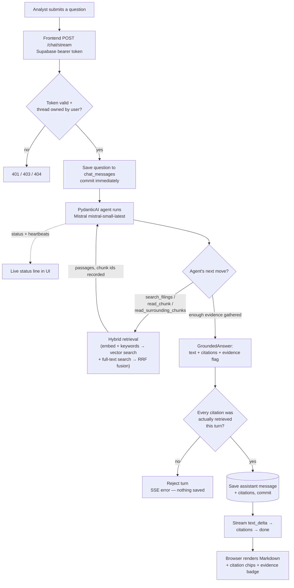
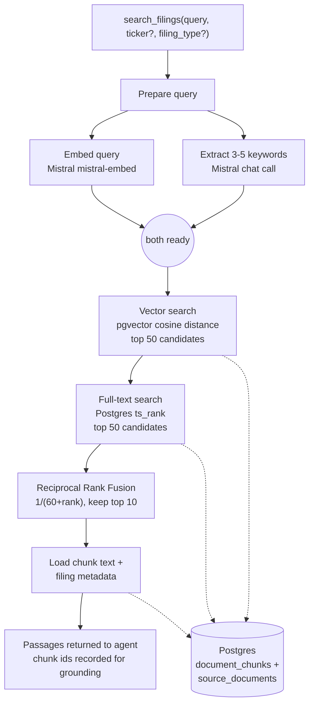

# Document Copilot — pipeline flowchart

This is a project-wide flowchart: how a SEC filing becomes a searchable chunk, and how an analyst's question becomes a cited answer. It complements [architecture.md](architecture.md) (system design and rationale) and [pipeline.md](pipeline.md) (line-by-line code walkthrough of a single chat turn). Start here for the shape of the whole project; go to `pipeline.md` when you need exact function names and call order.

Diagrams use Mermaid `flowchart` syntax — rectangles are processing steps, diamonds are decisions, cylinders are database storage. View in a Markdown preview that renders Mermaid.

## 1. End to end: two pipelines, one corpus

Document Copilot is really two pipelines that share one database. The **ingestion pipeline** (offline, run by a developer/operator) fills `source_documents` and `document_chunks`. The **chat pipeline** (online, triggered by an analyst) reads from those same tables to answer questions. Nothing in the chat pipeline downloads or indexes filings — if the corpus is empty, retrieval returns nothing.

## 2. Ingestion pipeline in detail

Four scripts, run in order, each depending on the previous step's output. Re-running a step is safe by default (it skips what's already done) and destructive only when `--update` / `--force` is passed.

Key coupling: chunk creation re-reads the *original HTML* (not the stored Markdown) so it can use document structure and provenance — refreshing a filing's Markdown alone does not refresh its chunks.

## 3. Chat pipeline in detail

One analyst turn, from keystroke to rendered citation chips. The agent can loop through retrieval more than once before answering — shown as the arrow back from retrieval to the agent.

### Retrieval, zoomed in

`search_filings` is the only tool that runs the full hybrid search; `read_chunk` and `read_surrounding_chunks` skip straight to loading specific rows by ID.

## Where to look next

| Question | Go to |
| --- | --- |
| Why is the system built this way? | [architecture.md](architecture.md) |
| Exact function names and call order for one turn? | [pipeline.md](pipeline.md) |
| How to run ingestion locally? | [../data/README.md](../data/README.md) |
| What's shipped vs. planned? | [todo.md](todo.md) |
