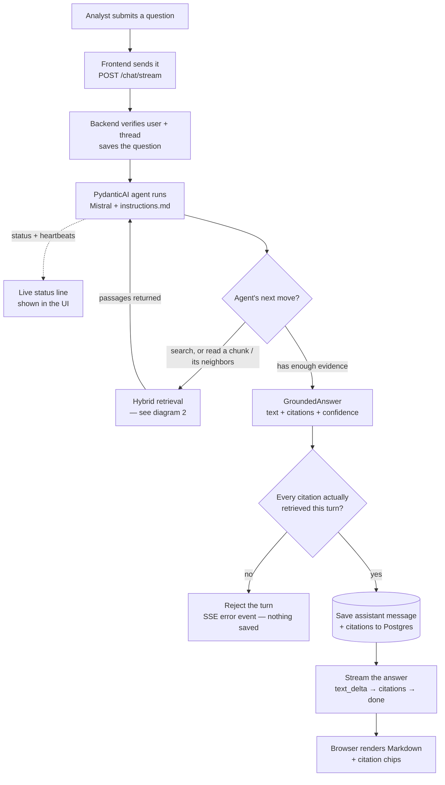
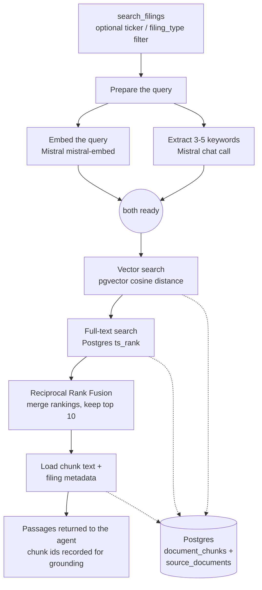

# Document Copilot pipeline

This document describes the current implementation, from preparing SEC filings to displaying a cited answer. Part 1 explains the complete workflow in English. Part 2 traces the same workflow through the code. Paths are relative to the repository root unless a link supplies its own relative path.

The application uses React and Vite for the browser, FastAPI for the API, Supabase Auth for authentication, SQLAlchemy for access to Supabase Postgres, and PydanticAI with Mistral for the assistant. Mistral also creates embeddings. Corpus preparation runs through separate Python scripts.

## Pipeline flowchart

This is a **flowchart**, also called a **pipeline diagram**. It uses Mermaid's `flowchart TD` syntax to arrange the workflow from top to bottom. Rectangles represent processing steps, diamonds represent decisions, and cylinders represent database storage. Solid arrows show execution or returned results; dotted arrows show database access. View these blocks in a Markdown preview that supports Mermaid to see them rendered.

It's split into two diagrams instead of one large one, because a single diagram covering the full turn *and* the internals of hybrid retrieval had enough nodes and crossing lines to be hard to read. The first diagram is the turn at a glance; the second zooms into the one step ("hybrid retrieval") that the first diagram collapses into a single box.

### Diagram 1 — one turn, start to finish

Query embedding and keyword extraction run concurrently; the two database searches inside retrieval run sequentially, not in parallel. The agent can loop through retrieval more than once (searching again, reading a specific chunk, or reading its neighbors) before it has enough to answer — that loop is the arrow back from "Hybrid retrieval" to "Agent runs." Status updates and heartbeats (the live status line the analyst sees while waiting) are a side channel off the agent, not part of the main data flow, so they're shown as a single dotted arrow rather than woven through every step.



### Diagram 2 — inside hybrid retrieval

This is what "Hybrid retrieval" in diagram 1 expands to. It covers all three of the agent's tools: `search_filings` runs this whole sequence; `read_chunk` and `read_surrounding_chunks` skip straight to loading rows from Postgres for a specific chunk (and its neighbors) instead of searching. Every passage any of the three tools returns gets its chunk id recorded for the validation step in diagram 1 — that's what makes the citation check possible.



Answer text starts only after generation, validation, and the assistant-message transaction commit — there's no live token-by-token generation reaching the browser, the "typing" effect is the already-complete answer being drip-fed. Both diagrams show the normal turn plus the one branch that matters most for trust (citation validation); Part 1 below covers authentication failures, timeouts, and cancellation in full. The sequence diagram in Part 2 shows the timing of requests between components.

## Part 1: Full English workflow

### 1. Prepare the searchable corpus

Before an analyst asks a question, the filing corpus must be downloaded and indexed. This preparation is separate from answering questions; sending a chat message does not download or ingest filings.

The downloader requests SEC submission metadata for AAPL, MSFT, NVDA, AMZN, and GOOGL. Its defaults select up to five 10-K filings per company whose report year, or filing year when the report date is missing, falls within the previous five calendar years. It saves the original HTML in year folders and writes a manifest containing each filing's identity, dates, original URL, and local path. The current `CLEAR_OUTPUT_DIR=True` setting removes the existing download directory before downloading.

Docling converts the downloaded HTML files into Markdown, preserving the directory layout. Conversion skips output that is already up to date unless `--force` is supplied. A separate importer combines the Markdown with manifest metadata and stores one `source_documents` row per filing, owned by the organization named with the required `--org` option (optionally limited to one `--ticker`). It stops before writing if that organization does not exist. The importer matches existing rows by source URL, skips them by default, and refreshes them, including their organization, when `--update` is supplied.

Chunk creation reads the original HTML again through Docling so it can use document structure and provenance. It requires the corresponding source-document row to exist. The default `HybridChunker` splits and merges content using document structure and an approximate 800-token budget. It retains heading context and repeats table headers. The optional hierarchical chunker follows document structure without the hybrid tokenizer budget. There is no fixed sliding-window overlap.

For each chunk, the script keeps the plain passage text and creates a contextualized version for embedding. Mistral embeds that contextualized text in batches of 64. The script verifies that every vector has the configured 1024 dimensions and stores the chunk's text, index, vector, token count, and available page/section metadata in `document_chunks`.

Postgres generates an English full-text search vector from the plain chunk text. The migrations create a GIN index for lexical search and an HNSW cosine index for vector search. Applying both migrations produces the current `vector(1024)` column; the dimension-change migration requires an empty chunk table.

Chunk ingestion skips a document if it already has any chunks, unless `--update` is supplied. The one-chunk smoke mode writes a real chunk for the first filing, so a later ordinary run will skip that filing. Rebuilding it requires `--update`, which replaces existing chunks for the selected filings. Refreshing source-document Markdown alone does not refresh its chunks or embeddings.

### 2. Sign in and open a conversation

The analyst signs in with email and password through Supabase Auth. The browser restores the session on page load and listens for authentication changes. Protected routes send users without a session to the login screen.

The sidebar requests the signed-in user's conversations. Creating a conversation inserts a thread owned by that user and navigates to its chat page. Opening a thread fetches its persisted messages and citation metadata. The browser converts those records into the AI SDK's message format and renders them.

Browser API requests attach the Supabase access token as a bearer token. FastAPI verifies it using Supabase Auth, resolves the corresponding application user, and checks thread ownership before returning messages or accepting a question. A missing thread returns 404, another user's thread returns 403, and missing or invalid authentication returns 401.

Which filings a user can search is a separate question from which threads they own. An admin grants organizations to users through `organization_members` (see `backend/scripts/manage_orgs.py`); each turn's retrieval is limited to documents of those organizations.

### 3. Submit and save the question

When the analyst submits a non-empty question, the chat component clears the input, starts its elapsed-time display, and calls the AI SDK's `sendMessage`. The custom transport sends the thread ID and the current messages' text parts to `POST /chat/stream` using `fetch`. This is a POST request whose response body carries Server-Sent Events (SSE).

The backend selects the latest user message from the submitted list. It rejects a missing or blank question, saves the question in `chat_messages`, and commits it before starting the assistant. This means a failed or cancelled answer can still leave the user's question in the conversation.

Although the browser sends its message list, the current orchestrator passes only the latest question to the model. It does not load or supply previous conversation messages as model history. Persisted chat history is currently used for display.

### 4. Run the assistant while reporting progress

The API starts the chat-turn orchestrator as an asynchronous task. At the same time, the response generator forwards progress events from a queue. A thread-safe callback lets the orchestrator and tool workers place progress updates on that queue.

While the task is pending, the generator checks for a disconnected client, checks the configured turn deadline, and waits up to half a second for the next status event. After about six seconds without a status event, it emits a "Still working on your answer..." heartbeat. These messages show activity; they do not contain answer text or prove how close generation is to completion.

The orchestrator builds dependencies for this turn: the user and thread IDs, a database session, a retriever, the user's organization IDs looked up from `organization_members`, a set of retrieved chunk IDs, a database lock, and the status callback. It runs the PydanticAI agent using the configured Mistral chat model, which defaults to `mistral-small-latest`.

The agent's instructions ask it to answer from retrieved passages, cite factual claims, provide real excerpts, and acknowledge insufficient evidence. The model decides which tools to call and can gather evidence over multiple tool rounds. The code does not force a fixed first tool or a fixed number of searches.

### 5. Retrieve evidence through the agent's tools

The agent has three tools. `search_filings` finds passages using semantic and lexical search, with optional ticker and filing-type filters. `read_chunk` reads one chunk by ID. `read_surrounding_chunks` reads a target chunk and its neighbors within the same document, ordered by chunk index. The default neighbor window is one chunk on either side.

Each search first performs two independent Mistral operations concurrently: embedding the query and extracting keywords for lexical search. Keyword extraction asks for three to five terms and joins the returned comma-separated terms with spaces. If extraction fails, returns nothing useful, or is disabled, lexical search uses the original query. Query embedding failures propagate to the turn's error handling.

After both preparations finish, the retriever executes vector search and then full-text search sequentially on the shared SQLAlchemy session. Vector search orders chunks by cosine distance. Full-text search uses `websearch_to_tsquery('english', ...)` and orders matches by `ts_rank`. Each branch returns up to 50 candidates by default.

Reciprocal Rank Fusion combines the ranked chunk IDs. A chunk receives `1 / (60 + rank)` for each ranking in which it appears, using ranks starting at one. These contributions are summed and sorted; the raw cosine and lexical scores are not added together. The retriever keeps the top ten IDs by default and loads their passage text and filing metadata in that order.

Every passage returned by any tool has its chunk ID added to the turn's retrieved-ID set. This includes neighboring passages. Tool access to the shared database session is serialized with a lock, even if PydanticAI schedules multiple synchronous tools in worker threads. The model-chosen filters cover ticker and filing type; there is no filing-year filter.

Every tool also passes the turn's organization IDs to the retriever, which adds `org_id = ANY(allowed_org_ids)` to both search queries, to passage loading, and to neighbor reads. The model cannot set or see this scope. A user with no organizations gets empty results without any Mistral calls, and documents with no organization are never returned.

### 6. Generate, validate, and save the answer

After gathering evidence, the agent returns a structured `GroundedAnswer`: answer text, a list of citations, and a Boolean `has_sufficient_evidence` flag. Each citation contains a chunk ID, quoted text, and optional page and section information.

The orchestrator validates that every cited chunk was returned by a tool during this turn. It also requires at least one citation when the answer claims sufficient evidence. An answer marked as having insufficient evidence may have valid partial citations or no citations. A violation raises `GroundingError` before the assistant answer is saved or streamed.

The validator currently checks chunk membership and citation presence. Exact quote matching, factual entailment, and whether every individual claim has a citation remain prompt requirements; this validator does not verify them. The evidence flag is a model-produced Boolean, not a measured confidence score.

After validation, the orchestrator inserts the assistant message and its citation rows. The message metadata stores the evidence flag. These helper functions flush the records, and the API commits the transaction after the orchestrator returns. The answer is therefore complete, validated, and committed before its first text event is emitted.

### 7. Deliver text and finish automatically

The backend splits the completed answer into groups of four space-separated words by default and emits each group as a `text_delta` event, with an eight-millisecond delay between groups. This produces a typing effect. The application does not stream Mistral's raw generation tokens to the browser.

After the text, the API loads citations with their linked source-document metadata, emits a `citations` event, and emits `done`. The custom browser transport decodes UTF-8 incrementally, buffers incomplete events, and translates complete text events into AI SDK text chunks. The first text event also changes the status caption to "Drafting your answer...". At this point the backend has already generated the answer; the caption describes its display phase.

The transport uses a `TransformStream` so it keeps consuming input when a network chunk contains only status information, citations, or part of an event. This handles the earlier bug where the reader stalled on progress updates and the answer appeared only after Stop triggered a database refresh.

On `done`, the transport emits `text-end` when text has started, emits the SDK's `finish` chunk, and terminates its output immediately. It does not wait for the HTTP connection to close. Normal end-of-file also flushes a buffered event and finishes the output if needed. The chat SDK can then return to ready without the analyst pressing Stop. React message updates are throttled to 50 milliseconds in `ChatSession`.

### 8. Refresh the saved answer and render its sources

When the SDK invokes `onFinish`, the chat component clears progress state and records elapsed time for a turn that was neither aborted nor errored. It starts a separate request for the conversation's persisted messages, replacing temporary streamed messages with database records and building a citation lookup by message ID. The displayed latency ends at the finish callback; it does not include that later refresh.

The transport intentionally ignores the SSE citation payload for rendering. The messages endpoint supplies the citation records with their ticker, filing type, filing date, document title, and source URL. If this refresh fails, the UI keeps the text already received and logs the refresh failure.

Assistant text is rendered as Markdown with GitHub-flavored Markdown support. Citation chips open popovers containing the excerpt, available location details, and a link to the original filing. When persisted message metadata marks evidence as insufficient, the message shows the limited-evidence badge.

### 9. Handle errors and cancellation

Failures before streaming begins use ordinary HTTP errors. During the pending-turn phase, grounding failures and unexpected exceptions roll back uncommitted assistant work and become SSE `error` events. The default 60-second turn deadline requests task cancellation, rolls back, and emits a timeout error. This deadline is checked while the orchestrator is pending; it does not include the earlier authentication work or the later typing phase.

The transport turns an SSE error into a stream error, which the chat UI displays. The SDK's finish callback also attempts to refresh persisted messages after aborted or errored turns. Already committed records remain available.

Pressing Stop aborts the browser request. The backend polls for disconnection and requests cancellation of its pending task; its generator cleanup also cancels an unfinished task. Cancellation of the asynchronous task does not guarantee that an already running synchronous worker or remote provider request stops immediately. If Stop is pressed after the answer has been committed, refreshing the conversation can still show that saved answer.

There is no stream-resume implementation: `reconnectToStream()` returns `null`. The parser also treats a clean end-of-file without `done` as completion, so that case is not independently classified as an incomplete answer. Errors while emitting text or loading final citation metadata occur outside the inner turn-error handler and may end the connection rather than produce its formatted SSE error.

## Part 2: Code workflow

### A. Corpus preparation call path

```text
data/download.py::download_filings()
  -> get_json() + extract_10k_filings()
  -> get_bytes()
  -> data/downloads/<year>/<filing>.htm[l]
  -> data/downloads/manifest.json

HTML + manifest
  |
  +-> data/convert_to_markdown.py::convert_directory()
  |     -> convert_file() -> DocumentConverter.convert()
  |     -> export_to_markdown() -> data/markdown/<year>/<filing>.md
  |     -> data/ingest_documents.py::ingest_directory(org_slug, ticker?)
  |          -> select_filings(ticker)
  |          -> get_org_by_slug() [stop if missing]
  |          -> ingest_filing(org_id) -> source_documents
  |          -> transaction commit
  |
  +-> data/ingest_chunks.py::main()  [source_documents must already exist]
        -> select_filings()
        -> SessionLocal.begin() for each filing
        -> ingest_document()
             -> source_document_for()
             -> DocumentConverter.convert(original HTML)
             -> make_chunker() -> chunker.chunk()
             -> chunk_text(): plain text + contextualized embedding text
             -> embedding_batches() -> Mistral embeddings.create()
             -> chunk_metadata()
             -> insert DocumentChunk rows -> transaction commit
        -> Postgres generates search_vector and maintains indexes
```

The chunking input is the original HTML. The stored Markdown and the searchable chunks are two outputs of corpus preparation, linked by `source_document_id`.

### B. Browser and API call path

```text
frontend/src/auth/AuthProvider.tsx
  -> Supabase signInWithPassword() / getSession()
frontend/src/auth/ProtectedRoute.tsx
  -> allow authenticated routes
frontend/src/components/chat/ThreadSidebar.tsx
  -> api.listThreads() / api.createThread()
frontend/src/pages/ChatPage.tsx
  -> api.getMessages(threadId)
  -> toUiMessage() + citationsByMessageId()
  -> ChatSession(initialMessages, initialCitations)

frontend/src/components/chat/ChatSession.tsx::handleSubmit()
  -> sendMessage({ text })                         [useChat]
  -> frontend/src/chat/transport.ts::FastApiChatTransport.sendMessages()
       -> toBackendMessage() for each UI message
       -> frontend/src/lib/http.ts::http.stream()
            -> getAccessToken()
            -> fetch(POST /chat/stream, JSON body, bearer token, abort signal)

backend/app/auth/dependencies.py::get_current_user()
  -> Supabase auth.get_user(access_token)
backend/app/database/session.py::get_db()
  -> request-scoped Session
backend/app/api/chat.py::stream_chat()
  -> require_owned_thread()
       -> database/users.py::get_or_create_user()
       -> database/chats.py::get_thread()
  -> latest_user_message.text().strip()
  -> database/chats.py::create_message(sender="user")
  -> db.commit()                                  [question saved]
  -> StreamingResponse(generate(), media_type="text/event-stream")
```

Example request shape; IDs are illustrative:

```json
{
  "threadId": "11111111-1111-4111-8111-111111111111",
  "messages": [
    {
      "id": "user-message-1",
      "role": "user",
      "parts": [{ "type": "text", "text": "What risks does AAPL describe?" }]
    }
  ]
}
```

### C. Turn orchestration and retrieval

The following is condensed Python-style pseudocode. It preserves the actual call order and transaction boundary; queue handling and error branches are described above.

```python
# backend/app/api/chat.py::generate()
task = asyncio.create_task(
    run_turn(db, thread.id, thread.user_id, user_content, status_callback=on_status)
)
while not task.done():
    # Check disconnection and deadline.
    # Forward queued status events; emit an idle heartbeat when due.
    ...
# Drain remaining status events.
message_row, answer = await task
db.commit()  # Commit assistant message and citations together.
# Emit completed answer text, enriched citations, then done.
```

```python
# backend/app/chat/orchestrator.py::run_chat_turn()
deps = DocumentAgentDeps(
    user_id=str(user_id),
    thread_id=str(thread_id),
    db=db,
    retriever=retriever or _default_retriever(),
    allowed_org_ids=get_user_org_ids(db, user_id),  # from organization_members
    on_status=status_callback,
)
result = await document_agent.run(user_message, deps=deps)
answer = result.output  # GroundedAnswer
validate_citations(answer, deps.retrieved_chunk_ids)
message = chats.create_message(
    db, thread_id, "assistant", answer.answer,
    metadata={"has_sufficient_evidence": answer.has_sufficient_evidence},
)
# Convert answer.citations to CitationInput values, then:
chats.create_citations(db, message.id, citation_inputs)
return message, answer  # API owns the commit.
```

```text
backend/app/assistant/agent.py::document_agent
  -> instructions.md + GroundedAnswer output schema
  -> model chooses one or more tool calls
       |
       +-> search_filings(query, ticker?, filing_type?)
       |     -> acquire deps.db_lock
       |     -> DocumentRetriever.search(allowed_org_ids=deps.allowed_org_ids)
       |          -> return [] if allowed_org_ids is empty
       |          -> ThreadPoolExecutor(max_workers=2)
       |               +-> _embed_query(query) -> Mistral embeddings.create()
       |               +-> _fulltext_query(query) -> extract_keywords()
       |          -> wait for both preparation results
       |          -> queries.vector_search()       [first DB query, org-scoped]
       |          -> queries.fulltext_search()     [second DB query, org-scoped]
       |          -> fusion.reciprocal_rank_fusion()[:top_k]
       |          -> _load_passages() -> SourcePassage[] [org-scoped]
       |     -> release lock; _remember(passages)
       |
       +-> read_chunk(chunk_id)
       |     -> locked retriever.read_surrounding_chunks(window=0, allowed_org_ids)
       |     -> _remember(); return passage or None
       |
       +-> read_surrounding_chunks(chunk_id, window=1)
             -> locked retriever.read_surrounding_chunks(allowed_org_ids)
             -> _remember(); return passages in chunk_index order
  -> model receives tool results and may call tools again
  -> final GroundedAnswer -> orchestrator validation
```

A `SourcePassage` includes `chunk_id`, `source_document_id`, `ticker`, `filing_type`, `filing_year`, `page_number`, `section_label`, `chunk_text`, `source_url`, and `score`. Search results carry the fused score; direct/neighbor reads use zero. The current passage mapper derives `filing_year` from the filing date, while ingestion metadata prefers the report date's year. Those values can differ for an annual filing submitted the following year.

### D. Streaming and rendering sequence

```mermaid
sequenceDiagram
    participant UI as ChatSession / useChat
    participant Transport as FastApiChatTransport
    participant API as FastAPI stream_chat
    participant Agent as run_chat_turn / document_agent
    participant DB as Postgres
    UI->>Transport: sendMessage(question)
    Transport->>API: POST /chat/stream + bearer token
    API->>DB: Save question and commit
    API->>Agent: Start asynchronous turn
    loop Agent works
        Agent-->>API: Status callback
        API-->>Transport: status event or idle heartbeat
        Transport-->>UI: Update caption
        Agent->>DB: Retrieve passages through tools
        DB-->>Agent: Passage text and metadata
    end
    Note over Agent: Produce GroundedAnswer and validate citation IDs
    Agent->>DB: Flush assistant message and citations
    Agent-->>API: Return message and answer
    API->>DB: Commit assistant transaction
    loop Completed answer in word groups
        API-->>Transport: text_delta
        Transport-->>UI: text-start / text-delta
    end
    API->>DB: Load enriched citations
    API-->>Transport: citations, then done
    Transport-->>UI: text-end + finish; terminate stream
    Note over UI: Ready; onFinish clears progress
    UI->>API: GET /chat/threads/{id}/messages
    API->>DB: Load messages + citations + source documents
    API-->>UI: Persisted records
    Note over UI: Render Markdown, citation chips, evidence badge
```

The diagram shows the successful path. Authentication, exceptions, cancellation, and keyword/query-embedding requests are expanded in the surrounding sections.

The backend SSE format is defined in [streaming.py](../backend/app/chat/streaming.py). Every event is `event: <name>`, a newline, `data: <JSON>`, and a blank line. The browser's [transport.ts](../frontend/src/chat/transport.ts) adapts this custom protocol to AI SDK chunks.

| Backend event | JSON payload | Browser behavior |
| --- | --- | --- |
| `status` | `{ "stage": "search", "message": "Searching filings..." }` | Calls the status callback; produces no SDK text chunk. |
| `text_delta` | `{ "text": "Answer fragment " }` | Emits `text-start` once, then `text-delta`; sets the typing caption on the first fragment. |
| `citations` | `{ "citations": [...] }` | Consumed without rendering; persisted citations arrive through the messages refresh. |
| `error` | `{ "message": "..." }` | Throws an error into the stream. |
| `done` | `{}` | Emits `text-end` if needed and `finish`, then terminates output. |

### E. Database relationships and API surface

```text
users
  -> chat_threads.user_id
       -> chat_messages.thread_id
            -> message_citations.message_id
                 -> document_chunks.id via nullable chunk_id
                      -> source_documents.id via source_document_id

users
  -> organization_members.user_id
       -> organizations.id via org_id
            -> source_documents.org_id
                 -> document_chunks.source_document_id
```

Source documents also have an optional `user_id`, which the ingestion scripts leave unset. Document visibility comes from `source_documents.org_id` and the user's `organization_members` rows; chunks inherit their document's organization. Chat privacy is enforced by the API's user and thread-ownership checks. The checked-in migrations create tables and indexes; they do not enable row-level security or create RLS policies.

| Endpoint | Handler | Purpose |
| --- | --- | --- |
| `GET /health` | `main.py::healthcheck` | Public service health. |
| `GET /me` | `main.py::current_user` | Authenticated Supabase user. |
| `GET /chat/threads` | `chat.py::list_chat_threads` | Current user's threads. |
| `POST /chat/threads` | `chat.py::create_chat_thread` | Create an owned thread. |
| `GET /chat/threads/{thread_id}/messages` | `chat.py::get_chat_messages` | Owned thread's messages with enriched citations. |
| `POST /chat/stream` | `chat.py::stream_chat` | Save the latest question and run a streamed turn. |

Citation display metadata follows the relationship from citation to chunk to source document. For the bulk chunk deletion used by ingestion `--update`, the database's `ON DELETE SET NULL` preserves the citation row and quoted text but removes its old chunk link. Such a citation can no longer obtain source metadata through that relationship.

### F. Configuration that changes the workflow

These are source-code defaults, not a report of private `.env` values. Backend settings live in [config.py](../backend/app/config.py); browser settings live in [env.ts](../frontend/src/lib/env.ts).

| Setting or constant | Default | Effect |
| --- | --- | --- |
| `mistral_chat_model` | `mistral-small-latest` | Agent generation and keyword extraction model. |
| `mistral_embedding_model` / `mistral_embedding_dimensions` | `mistral-embed` / `1024` | Corpus and query embeddings; ingestion validates vector size. |
| `retrieval_candidate_k` / `retrieval_top_k` | `50` / `10` | Candidates per search branch and final passages per search. |
| `retrieval_rrf_k` | `60` | Rank-fusion smoothing constant. |
| `retrieval_neighbor_window` | `1` | Default context on each side of a target chunk. |
| `retrieval_keyword_extraction_enabled` | `True` | Enables the keyword-extraction completion. |
| `retrieval_keyword_extraction_timeout_ms` | `6000` | Timeout passed to the keyword-extraction request. |
| `mistral_request_timeout_ms` | `15000` | Timeout passed to query embedding; the agent constructor does not pass this setting to its provider. |
| `chat_turn_timeout_seconds` | `60` | Deadline checked while the turn task is pending. |
| `chat_heartbeat_interval_seconds` | `6.0` | Idle interval before another progress heartbeat. |
| `chat_typing_chunk_words` / `chat_typing_delay_seconds` | `4` / `0.008` | Word groups and delay when displaying a completed answer. |
| `ChatSession` SDK `throttle` | `50` ms | Batches React message updates. |
| `http.ts::DEFAULT_TIMEOUT_MS` | `15000` | Ordinary JSON requests; `http.stream` uses the SDK abort signal instead. |
| Ingestion `--max-tokens` / `--batch-size` | `800` / `64` | Hybrid chunk sizing estimate and embedding batch size. |

### G. Source map and existing verification

| Concern | Implementation | Existing verification |
| --- | --- | --- |
| Document import and chunk preparation | [ingest_documents.py](../data/ingest_documents.py), [ingest_chunks.py](../data/ingest_chunks.py) | [Ingestion tests](../backend/tests/ingest) |
| Organizations, membership, document scope | [manage_orgs.py](../backend/scripts/manage_orgs.py), [organizations.py](../backend/app/database/organizations.py), org filters in [Retrieval modules](../backend/app/retrieval) | [Admin CLI tests](../backend/tests/scripts/test_manage_orgs.py), [Retrieval tests](../backend/tests/retrieval), [Agent tests](../backend/tests/assistant/test_agent.py) |
| Retrieval, filters, keywords, fusion, neighbors | [Retrieval modules](../backend/app/retrieval) | [Retrieval tests](../backend/tests/retrieval) |
| Tool execution and retrieved-ID tracking | [agent.py](../backend/app/assistant/agent.py), [deps.py](../backend/app/assistant/deps.py) | [Agent tests](../backend/tests/assistant/test_agent.py) |
| Structured answer and citation validation | [outputs.py](../backend/app/assistant/outputs.py), [validator.py](../backend/app/grounding/validator.py) | [Grounding tests](../backend/tests/grounding/test_validator.py) |
| Ownership, persistence, SSE errors, heartbeat, cancellation | [Chat API](../backend/app/api/chat.py), [orchestrator.py](../backend/app/chat/orchestrator.py) | [Chat API tests](../backend/tests/test_chat_api.py), [schema and formatting tests](../backend/tests/chat) |
| Stream adaptation and final rendering | [transport.ts](../frontend/src/chat/transport.ts), [ChatSession.tsx](../frontend/src/components/chat/ChatSession.tsx), [MessageList.tsx](../frontend/src/components/chat/MessageList.tsx) | Browser verification, TypeScript checks, and lint per frontend instructions. |

This source map identifies the existing checks; rewriting this document does not run ingestion, migrations, live model requests, or the application test suites.
